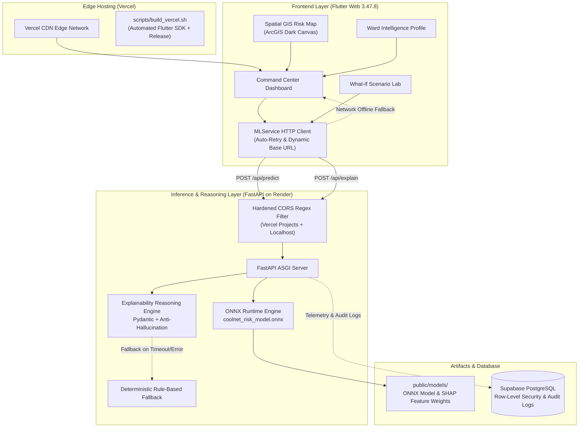

# 🌐 CoolNet AI — Urban Climate & Grid Resilience Intelligence

[](https://flutter.dev)
[](https://fastapi.tiangolo.com)
[](https://onnxruntime.ai)
[](https://coolnet-ai-phase1-theta.vercel.app/)
[](https://coolnet-ai-backend.onrender.com/health)
[](LICENSE)

CoolNet AI is an AI-powered climate-resilience command center combining atmospheric heat stress, electrical grid vulnerability, and socioeconomic susceptibility into spatial ward-level compound risk intelligence.

🚀 **Live Production Dashboard**: [https://coolnet-ai-phase1-theta.vercel.app/](https://coolnet-ai-phase1-theta.vercel.app/)  
⚡ **Live Backend Service**: [https://coolnet-ai-backend.onrender.com](https://coolnet-ai-backend.onrender.com) ([Health Check](https://coolnet-ai-backend.onrender.com/health) | [Swagger API Docs](https://coolnet-ai-backend.onrender.com/docs))

> **⚠️ Prototype & Data Disclosure:** The application currently operates with calibrated demographic, meteorological, and grid proxy data for Delhi municipal wards. Predictions from the ONNX ensemble model and the local prototype engine represent calibrated simulations for urban resilience planning, **not real-time utility SCADA telemetry, outage guarantees, or emergency evacuation directives**.

---

## 🎯 Key Capabilities

- **Spatial Compound Risk Mapping**: Interactive GIS map visualizing ward-level heat and grid vulnerability across Delhi using keyless ArcGIS Dark Gray Canvas tiles with zero watermarks.
- **Real-Time ONNX Machine Learning**: Low-latency model inference powered by a `GradientBoostingRegressor` trained on meteorological, demographic, and grid indicators.
- **Explainable AI (XAI)**: Factor attribution breakdown calculating percentage weights and contribution scores across Heat Index, Electricity Demand, Social Vulnerability, and Outage Probability.
- **Interactive What-If Scenario Lab**: Dynamic simulation lab adjusting ambient temperature (+0°C to +5°C), grid demand (+0% to +30%), and cooling access (-20% to +20%) to observe immediate impact on ward risk profiles.
- **Resilient Connectivity & Offline Fallback**: Automatic background retry polling and seamless graceful degradation to local deterministic scoring if the backend is waking from cold-start or unreachable.
- **Anti-Hallucination Guardrails**: Multi-rule Pydantic validators enforcing numerical bounds, verifiable evidence grounding, and deterministic fallbacks.

---

## 🏗️ System Architecture



---

## 📁 Repository Directory Structure

```
CoolNet-AI/
├── .github/
│   └── workflows/
│       └── ci.yml                 # GitHub Actions CI matrix (Flutter + Python + Security)
│
├── backend/                       # Python FastAPI Backend Service
│   ├── __init__.py                # Module initialization
│   ├── server.py                  # FastAPI app, endpoints (/health, /api/predict, /api/explain)
│   └── tests/
│       ├── __init__.py
│       └── test_server.py         # Backend API, CORS, and ONNX unit tests (7 tests)
│
├── docs/
│   └── PRODUCT_AND_ARCHITECTURE_REVIEW.md  # Architecture review, roadmaps, and audits
│
├── lib/                           # Flutter Frontend Application Source
│   ├── main.dart                  # Application entry point & theme initialization
│   ├── models/                    # Data models & schemas
│   │   ├── risk_data.dart         # Risk assessment, predictions, factor contributions
│   │   └── ward.dart              # Ward geographic and demographic metadata
│   ├── physics/                   # Physical calculations & formulas
│   │   ├── heat_diffusion.dart    # Spatial heat diffusion algorithms
│   │   └── heat_index.dart        # NOAA NWS Rothfusz heat index equation
│   ├── services/                  # Business logic & external API clients
│   │   ├── geocoding_service.dart # Reverse geocoding and location resolution
│   │   ├── grid_service.dart      # Grid stress and feeder calculations
│   │   ├── ml_service.dart        # Backend HTTP client, retry polling, ONNX integration
│   │   └── mock_data_service.dart # Calibrated sample ward dataset (20 Delhi wards)
│   ├── views/
│   │   └── dashboard_view.dart    # Main Command Center visual layout & state management
│   └── widgets/                   # Modular UI components
│       ├── header_widget.dart     # Navigation, active status pill, live backend polling
│       ├── overview_metrics_widget.dart  # Top high-level summary telemetry cards
│       ├── risk_map_widget.dart   # Interactive GIS map using ArcGIS Dark Canvas
│       ├── simulation_widget.dart # What-If scenario laboratory with reactive sliders
│       ├── ward_detail_widget.dart# Ward intelligence profile & factor contributions
│       └── ward_list_widget.dart  # Sorted risk watchlist with ward search & filter
│
├── llm/                           # Anti-Hallucination Reasoning Layer
│   ├── __init__.py
│   ├── client.py                  # LLM provider integration client
│   ├── config.py                  # LLM hyperparameters and environment settings
│   ├── exceptions.py              # Custom validation & safety exceptions
│   ├── prompts.py                 # Grounded explanation system prompts
│   ├── schemas.py                 # Pydantic input and output contracts
│   ├── service.py                 # Structured reasoning orchestrator
│   ├── tests/
│   │   ├── __init__.py
│   │   ├── run_tests.py           # LLM test runner
│   │   └── test_validation.py     # 19 anti-hallucination unit tests
│   └── validators.py              # Strict bounds checking and validation logic
│
├── public/
│   └── models/                    # ML Model Artifacts & Metadata
│       ├── coolnet_risk_model.onnx        # Trained ONNX GradientBoostingRegressor (109 KB)
│       └── feature_importances.json      # Precomputed SHAP feature weights
│
├── scripts/                       # Build & Machine Learning Utilities
│   ├── build_vercel.sh            # Automated Flutter SDK installation & build script for Vercel
│   ├── test_inference.py          # Standalone ONNX runtime test suite
│   └── train_model.py             # Model training & ONNX export pipeline
│
├── supabase/                      # Database & Migration Scripts
│   └── schema.sql                 # PostgreSQL schema with Row-Level Security (RLS) & audit logs
│
├── test/                          # Flutter Frontend Unit Tests
│   ├── risk_engine_test.dart      # Risk calculations & deterministic formula tests (9 tests)
│   └── widget_test.dart           # UI widget integration smoke tests
│
├── .env.example                   # Environment variable template
├── firebase.json                  # Firebase Hosting SPA rewrite configuration
├── package.json                   # Build tooling metadata
├── pubspec.yaml                   # Flutter dependencies & Dart SDK constraints (^3.12.0)
├── render.yaml                    # Render Web Service blueprint specification
├── requirements.txt               # Pinned Python backend dependencies
└── vercel.json                    # Vercel deployment configuration (build & output routes)
```

---

## 🔢 7-Feature ML Input Vector Contract

The ONNX model expects a strictly ordered 7-dimensional numeric feature vector:

| Index | Feature Key | Data Type | Units | Description |
|:---:|---|:---:|:---:|---|
| `0` | `temperature` | `float32` | °C | Dry-bulb ambient air temperature |
| `1` | `humidity` | `float32` | % | Relative humidity (0 - 100) |
| `2` | `heat_index` | `float32` | °C | NOAA Rothfusz calculated apparent temperature |
| `3` | `electricity_demand` | `float32` | % | Normalized electrical feeder load proxy |
| `4` | `outage_probability` | `float32` | ratio | Estimated grid failure likelihood (0.0 - 1.0) |
| `5` | `population_density` | `float32` | people/km²| Ward demographic density |
| `6` | `vulnerability_index` | `float32` | index | Composite socioeconomic vulnerability score (0.0 - 1.0) |

---

## 🧪 Verification & Test Results (100% Pass)

| Test Suite | Scope | Result | Status |
|---|---|:---:|:---:|
| **Flutter Risk Engine** | `test/risk_engine_test.dart` | `9 / 9` passed | ✅ **100%** |
| **Flutter Static Analysis** | `flutter analyze` | `0` issues | ✅ **100%** |
| **Python Backend API** | `backend/tests/test_server.py` | `7 / 7` passed | ✅ **100%** |
| **Explainable AI Reasoning**| `llm/tests/test_validation.py` | `19 / 19` passed | ✅ **100%** |
| **ONNX Runtime Scenarios** | `scripts/test_inference.py` | `4 / 4` scenarios | ✅ **100%** |
| **GitHub Actions CI** | Multi-OS build & test matrix | All jobs green | ✅ **100%** |

---

## 🛠️ Local Development Setup

### 1. Prerequisites
- **Flutter SDK**: 3.47.8 or 3.44.0+ (with Dart SDK `^3.12.0`)
- **Python**: 3.10, 3.11, or 3.12
- **Git**

### 2. Backend Setup (FastAPI + ONNX Runtime)

```bash
# 1. Create and activate a virtual environment
python -m venv .venv

# On Linux/macOS:
source .venv/bin/activate
# On Windows (PowerShell):
.venv\Scripts\Activate.ps1

# 2. Install dependencies
pip install -r requirements.txt

# 3. Start development server
uvicorn backend.server:app --host 127.0.0.1 --port 8000 --reload
```

- Interactive Swagger Docs: [http://127.0.0.1:8000/docs](http://127.0.0.1:8000/docs)
- Health Check: [http://127.0.0.1:8000/health](http://127.0.0.1:8000/health)

### 3. Frontend Setup (Flutter Web)

```bash
# 1. Fetch dependencies
flutter pub get

# 2. Run in Chrome pointing to local backend
flutter run -d chrome --dart-define=API_BASE_URL=http://127.0.0.1:8000

# To run pointing to live Render backend:
flutter run -d chrome --dart-define=API_BASE_URL=https://coolnet-ai-backend.onrender.com
```

---

## 🚢 Production Deployment

### Frontend (Vercel)
The application is deployed to Vercel using `scripts/build_vercel.sh`:
- **Build Command**: `bash scripts/build_vercel.sh`
- **Output Directory**: `build/web`
- The script automatically installs Flutter 3.47.8 in the Vercel Linux container, executes `flutter pub get`, and compiles an optimized release bundle targeting the live Render backend.

### Backend (Render)
The FastAPI backend runs as a Render Web Service specified via `render.yaml`:
- **Build Command**: `pip install -r requirements.txt`
- **Start Command**: `uvicorn backend.server:app --host 0.0.0.0 --port $PORT`
- **CORS Protection**: Hardened regex allows `coolnet-ai*.vercel.app` and localhost dev ports while rejecting untrusted domains.

---

## 📜 License

This project is licensed under the MIT License — see the [LICENSE](LICENSE) file for details.
