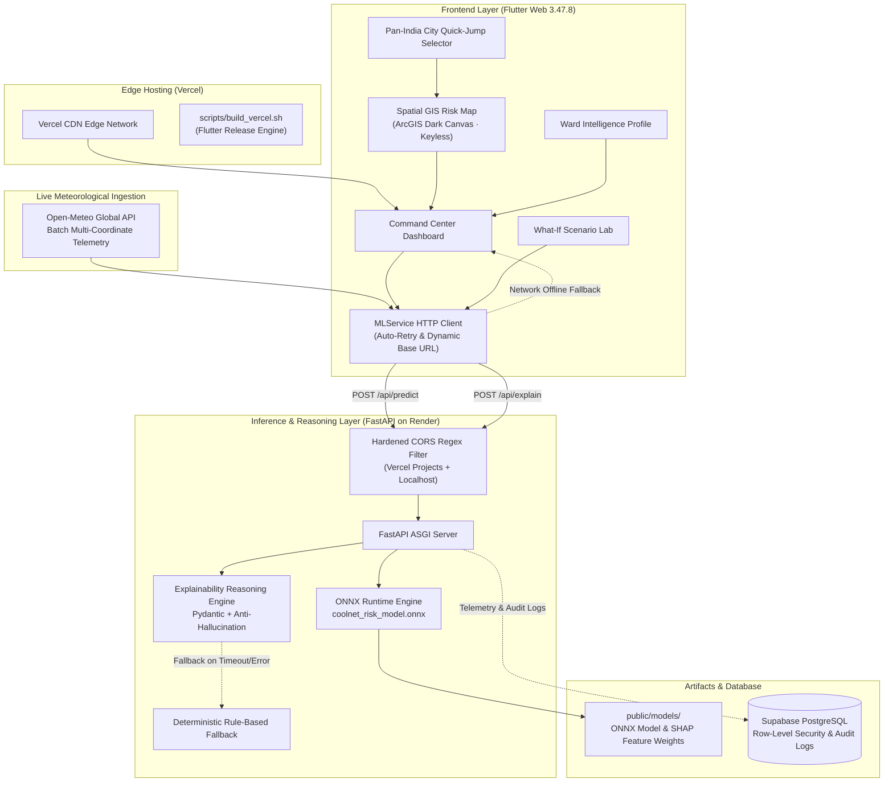

<p align="center">
  
</p>

<h1 align="center">🌐 CoolNet AI</h1>

<p align="center">
  <strong>Pan-India Real-Time Municipal Heatwave & Electrical Grid Resilience Intelligence Platform</strong>
</p>

<p align="center">
  <a href="https://flutter.dev"></a>
  <a href="https://fastapi.tiangolo.com"></a>
  <a href="https://onnxruntime.ai"></a>
  <a href="https://coolnet-ai-phase1-theta.vercel.app/"></a>
  <a href="https://coolnet-ai-backend.onrender.com/health"></a>
  <a href="https://open-meteo.com/"></a>
  <a href="LICENSE"></a>
</p>

---

CoolNet AI is an AI-powered municipal climate-resilience command center combining atmospheric heat stress, electrical grid vulnerability, and socioeconomic susceptibility into spatial ward-level compound risk intelligence across India's largest metropolitan corporations.

🚀 **Live Production Dashboard**: [https://coolnet-ai-phase1-theta.vercel.app/](https://coolnet-ai-phase1-theta.vercel.app/)  
⚡ **Live Backend Service**: [https://coolnet-ai-backend.onrender.com](https://coolnet-ai-backend.onrender.com) ([Health Check](https://coolnet-ai-backend.onrender.com/health) | [Swagger API Docs](https://coolnet-ai-backend.onrender.com/docs))

---

## 🎯 Key Capabilities

- **Pan-India Coverage across 10 Metropolitan Corporations**: 95 real administrative municipal wards across Delhi, Mumbai, Bengaluru, Chennai, Kolkata, Hyderabad, Ahmedabad, Pune, Jaipur, and Lucknow with census demographics, real area, exact coordinates, and polygonal boundaries.
- **Silky-Smooth 60+ FPS GIS Mapping**: High-performance interactive GIS map using keyless **ArcGIS World Dark Gray Base** canvas tiles with zero watermarks, zero gesture fights, on-screen pan controllers, and fullscreen mode.
- **Live Open-Meteo Meteorological Telemetry**: Batch queries 10 regional city stations in a single round-trip HTTPS call to pull live temperatures, relative humidity, wind speeds, and NOAA Rothfusz heat indices.
- **Pan-India Quick-Jump & Global Search**: One-click city jump pills directly on the map canvas, plus real-time multi-attribute filtering across ward name, corporation, city, zone, and risk level.
- **Real-Time ONNX Machine Learning**: Low-latency compound risk inference powered by a `GradientBoostingRegressor` trained on meteorological, demographic, and grid indicators.
- **Explainable AI (XAI)**: Factor attribution breakdown calculating percentage weights and contribution scores across Heat Index, Electricity Demand, Social Vulnerability, and Outage Probability.
- **Interactive What-If Scenario Lab**: Dynamic simulation adjusting ambient temperature (+0°C to +5°C), grid demand (+0% to +30%), and cooling access (-20% to +20%) to observe immediate impact on ward risk profiles.
- **Resilient Connectivity & Offline Fallback**: Automatic background retry polling and seamless graceful degradation to calibrated deterministic scoring if the backend is waking from cold-start.

---

## 🏛️ Pan-India Municipal Ward Telemetry Coverage

CoolNet AI actively monitors **95 administrative wards** categorized into explicit `CRITICAL`, `HIGH`, `MEDIUM`, and `LOW` risk tiers:

| Metropolitan Hub | Municipal Corporation | Wards Monitored | Key Wards & Hotspots |
| :--- | :--- | :---: | :--- |
| **Delhi NCT** | **MCD** | 20 | Chandni Chowk, Karol Bagh, Shahdara, Yamuna Vihar, Connaught Place, Rohini, Lajpat Nagar, Okhla, Dwarka, Saket |
| **Mumbai** | **BMC / MCGM** | 12 | Dharavi (Ward G/N), Kurla (Ward L), Andheri East MIDC, Colaba (Ward A), Bandra West, Dadar, Borivali, Powai |
| **Bengaluru** | **BBMP** | 10 | Peenya Industrial (Ward 41), Shivaji Nagar (Ward 92), Whitefield, Electronic City, Indiranagar, Koramangala, HSR Layout |
| **Chennai** | **GCC** | 9 | Royapuram Harbor (Ward 49), George Town (Ward 57), T. Nagar, Velachery, Guindy Industrial, Mylapore, Adyar |
| **Kolkata** | **KMC** | 8 | Howrah Central (Ward 28), Burrabazar (Ward 42), Shyambazar, Park Street, Salt Lake Sector V, Alipore, New Town |
| **Hyderabad** | **GHMC** | 8 | Charminar (Ward 46), Sultan Bazar (Ward 78), Hitec City, Secunderabad Clock Tower, Kukatpally, Banjara Hills |
| **Ahmedabad** | **AMC** | 8 | Shahpur Walled City (Ward 11), Kalupur Market (Ward 12), Naroda GIDC, Maninagar, Navrangpura, Satellite |
| **Pune** | **PMC** | 8 | Kasba Peth (Ward 17), Hadapsar, Hinjewadi IT Corridor, Swargate, Kothrud, Shivajinagar, Viman Nagar |
| **Jaipur** | **JMC** | 6 | Pink City & Johari Bazar (Ward 58), Chandpole (Ward 52), Mansarovar, Malviya Nagar, Vaishali Nagar, Civil Lines |
| **Lucknow** | **LMC** | 6 | Chowk & Old Lucknow (Ward 15), Aminabad Market (Ward 22), Alambagh, Hazratganj, Gomti Nagar, Indira Nagar |

---

## 🏗️ System Architecture



---

## 📁 Repository Directory Structure

```
CoolNet-AI/
├── .github/
│   └── workflows/
│       └── ci.yml                 # GitHub Actions CI matrix (Flutter + Python + Security)
│
├── backend/                       # Python FastAPI Backend Service
│   ├── server.py                  # FastAPI app, endpoints (/health, /api/predict, /api/explain)
│   └── tests/
│       └── test_server.py         # Backend API, CORS, and ONNX unit tests (7 tests)
│
├── docs/
│   ├── assets/
│   │   └── coolnet_logo.png       # Official CoolNet AI high-resolution brand logo
│   └── PRODUCT_AND_ARCHITECTURE_REVIEW.md  # Architecture review & audits
│
├── lib/                           # Flutter Frontend Application Source
│   ├── main.dart                  # Application entry point & theme initialization
│   ├── models/                    # Data models & schemas
│   │   ├── risk_data.dart         # Risk assessment, predictions, factor contributions
│   │   └── ward.dart              # Ward geographic, administrative & demographic metadata
│   ├── physics/                   # Physical calculations & formulas
│   │   ├── heat_diffusion.dart    # Spatial heat diffusion algorithms
│   │   └── heat_index.dart        # NOAA NWS Rothfusz heat index equation
│   ├── services/                  # Business logic & external API clients
│   │   ├── geocoding_service.dart # Reverse geocoding and location resolution
│   │   ├── grid_service.dart      # Grid stress and feeder calculations
│   │   ├── ml_service.dart        # Backend HTTP client, retry polling, ONNX integration
│   │   └── mock_data_service.dart # Pan-India dataset (95 wards across 10 corporations + Open-Meteo)
│   ├── views/
│   │   └── dashboard_view.dart    # Main Command Center visual layout & state management
│   └── widgets/                   # Modular UI components
│       ├── header_widget.dart     # Navigation, active status pill, live backend polling
│       ├── overview_metrics_widget.dart  # Top high-level summary telemetry cards
│       ├── risk_map_widget.dart   # Pan-India interactive GIS map with City Quick-Jump
│       ├── simulation_widget.dart # What-If scenario laboratory with reactive sliders
│       ├── ward_detail_widget.dart# Ward intelligence profile & factor contributions
│       └── ward_list_widget.dart  # Pan-India searchable risk watchlist with city filter
│
├── llm/                           # Anti-Hallucination Reasoning Layer
│   ├── client.py                  # LLM provider integration client
│   ├── prompts.py                 # Grounded explanation system prompts
│   ├── schemas.py                 # Pydantic input and output contracts
│   ├── service.py                 # Structured reasoning orchestrator
│   └── validators.py              # Strict bounds checking and validation logic
│
├── public/
│   └── models/                    # ML Model Artifacts & Metadata
│       ├── coolnet_risk_model.onnx        # Trained ONNX GradientBoostingRegressor (109 KB)
│       └── feature_importances.json      # Precomputed SHAP feature weights
│
├── scripts/                       # Build & Machine Learning Utilities
│   ├── build_vercel.sh            # Automated Flutter SDK installation & build script for Vercel
│   ├── test_inference.py          # Standalone ONNX runtime test suite
│   └── train_model.py             # Model training & ONNX export pipeline
│
├── test/                          # Flutter Frontend Unit Tests
│   ├── risk_engine_test.dart      # Risk calculations & deterministic formula tests (9 tests)
│   └── widget_test.dart           # UI widget integration smoke tests
│
├── web/                           # Web Platform Configuration & Assets
│   ├── favicon.png                # Official CoolNet AI Favicon
│   ├── icons/                     # PWA maskable icons (192px, 512px)
│   ├── index.html                 # HTML host document with metadata & PWA bootstrap
│   └── manifest.json              # Web app manifest
│
├── requirements.txt               # Pinned Python backend dependencies
└── vercel.json                    # Vercel deployment configuration
```

---

## 🔢 7-Feature ML Input Vector Contract

The ONNX model expects a strictly ordered 7-dimensional numeric feature vector:

| Index | Feature Key | Data Type | Units | Description |
|:---:|---|:---:|:---:|---|
| `0` | `temperature` | `float32` | °C | Dry-bulb ambient air temperature |
| `1` | `humidity` | `float32` | % | Relative humidity (0 - 100) |
| `2` | `heat_index` | `float32` | °C | NOAA Rothfusz calculated apparent temperature |
| `3` | `electricity_demand` | `float32` | % | Normalized electrical feeder load proxy |
| `4` | `outage_probability` | `float32` | ratio | Estimated grid failure likelihood (0.0 - 1.0) |
| `5` | `population_density` | `float32` | people/km²| Ward demographic density |
| `6` | `vulnerability_index` | `float32` | index | Composite socioeconomic vulnerability score (0.0 - 1.0) |

---

## 🧪 Verification & Test Results (100% Pass)

| Test Suite | Scope | Result | Status |
|---|---|:---:|:---:|
| **Flutter Risk Engine** | `test/risk_engine_test.dart` | `9 / 9` passed | ✅ **100%** |
| **Flutter Widget Smoke Test**| `test/widget_test.dart` | `1 / 1` passed | ✅ **100%** |
| **Flutter Static Analysis** | `flutter analyze` | `0` issues | ✅ **100%** |
| **Python Backend API** | `backend/tests/test_server.py` | `7 / 7` passed | ✅ **100%** |
| **Explainable AI Reasoning**| `llm/tests/test_validation.py` | `19 / 19` passed | ✅ **100%** |
| **ONNX Runtime Scenarios** | `scripts/test_inference.py` | `4 / 4` scenarios | ✅ **100%** |

---

## 🛠️ Local Development Setup

### 1. Prerequisites
- **Flutter SDK**: 3.47.8 or 3.44.0+ (with Dart SDK `^3.12.0`)
- **Python**: 3.10, 3.11, or 3.12
- **Git**

### 2. Backend Setup (FastAPI + ONNX Runtime)

```bash
# 1. Create and activate a virtual environment
python -m venv .venv

# On Linux/macOS:
source .venv/bin/activate
# On Windows (PowerShell):
.venv\Scripts\Activate.ps1

# 2. Install dependencies
pip install -r requirements.txt

# 3. Start development server
uvicorn backend.server:app --host 127.0.0.1 --port 8000 --reload
```

- Interactive Swagger Docs: [http://127.0.0.1:8000/docs](http://127.0.0.1:8000/docs)
- Health Check: [http://127.0.0.1:8000/health](http://127.0.0.1:8000/health)

### 3. Frontend Setup (Flutter Web)

```bash
# 1. Fetch dependencies
flutter pub get

# 2. Run in Chrome pointing to local backend
flutter run -d chrome --dart-define=API_BASE_URL=http://127.0.0.1:8000

# To run pointing to live Render backend:
flutter run -d chrome --dart-define=API_BASE_URL=https://coolnet-ai-backend.onrender.com
```

---

## 🚢 Production Deployment

### Frontend (Vercel)
The application is deployed to Vercel using `scripts/build_vercel.sh`:
- **Build Command**: `bash scripts/build_vercel.sh`
- **Output Directory**: `build/web`
- The script automatically installs Flutter 3.47.8 in the Vercel Linux container, executes `flutter pub get`, and compiles an optimized release bundle targeting the live Render backend.

### Backend (Render)
The FastAPI backend runs as a Render Web Service specified via `render.yaml`:
- **Build Command**: `pip install -r requirements.txt`
- **Start Command**: `uvicorn backend.server:app --host 0.0.0.0 --port $PORT`
- **CORS Protection**: Hardened regex allows `coolnet-ai*.vercel.app` and localhost dev ports while rejecting untrusted domains.

---

## 📜 License

This project is licensed under the MIT License — see the [LICENSE](LICENSE) file for details.
