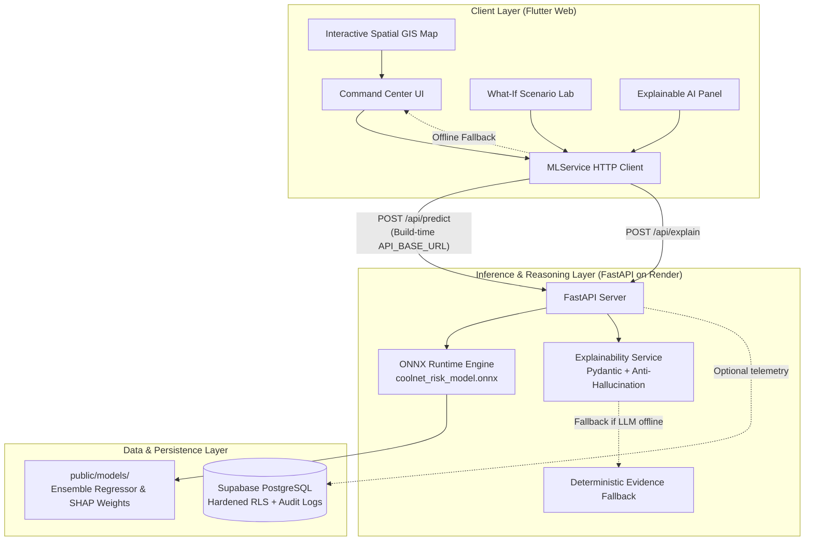

# 🌐 CoolNet AI — Urban Climate & Grid Resilience Intelligence

CoolNet AI is an AI-powered climate-resilience command center combining atmospheric heat stress, electrical grid vulnerability, and socioeconomic susceptibility into spatial ward-level compound risk intelligence.

> **⚠️ Prototype & Data Disclosure:** The application currently runs on calibrated sample demographic, meteorological, and grid proxy data for Delhi wards. Predictions from the ONNX model and the local prototype engine represent calibrated simulations for urban resilience planning, **not real-time utility SCADA telemetry, outage guarantees, or emergency evacuation alerts**.

---

## 🏗️ Architecture



---

## 🧪 Implementation & Verification Status

| Component | Status | Verification Detail |
|---|---|---|
| **Flutter Frontend** | ✅ Verified | Tested on Flutter 3.44.0 / 3.47.8 (Dart ^3.12.0); `flutter analyze` (0 issues), `flutter test` (9/9 passed). |
| **Web Build Release** | ✅ Verified | Release bundle compiles cleanly via `flutter build web --release` into `build/web`. |
| **FastAPI Backend** | ✅ Verified | `backend/server.py` with `/health`, `/api/predict`, `/api/explain` (5/5 unit tests pass). |
| **ONNX Runtime ML** | ✅ Verified | `public/models/coolnet_risk_model.onnx` (109 KB); all 4 test inference scenarios verified. |
| **7-Feature Ordering** | ✅ Verified | Strictly enforced: `[temperature, humidity, heat_index, electricity_demand, outage_probability, population_density, vulnerability_index]`. |
| **Explainable AI** | ✅ Verified | 19 LLM unit tests pass (`llm/tests/run_tests.py`); anti-hallucination bounds & deterministic fallback. |
| **Supabase Security** | ✅ Hardened | Explicit RLS policies (read-only telemetry, authenticated simulations), SQL check constraints, security audit logging. |
| **Deployment Configs** | ✅ Configured | `render.yaml` (Render Web Service), `firebase.json` (Firebase Hosting SPA), `vercel.json` (Vercel). |

---

## 📋 Prerequisites

- **Flutter SDK**: 3.47.8 / 3.44.0 (Bundled Dart SDK ^3.12.0)
- **Python**: 3.10, 3.11, or 3.12 (Virtual environment recommended)
- **Node.js**: v18+ (if utilizing Firebase CLI or Vercel CLI)

---

## 🚀 Local Development Setup

### 1. Backend Service (FastAPI + ONNX Runtime)

```bash
# 1. Create and activate a Python virtual environment
python -m venv .venv

# On Linux/macOS:
source .venv/bin/activate
# On Windows (PowerShell):
.venv\Scripts\Activate.ps1

# 2. Install pinned dependencies
pip install -r requirements.txt

# 3. Configure local environment
copy .env.example .env

# 4. Start the FastAPI development server
uvicorn backend.server:app --host 127.0.0.1 --port 8000 --reload
```

The API will be accessible at:
- Swagger Interactive Docs: [http://127.0.0.1:8000/docs](http://127.0.0.1:8000/docs)
- Health Check: [http://127.0.0.1:8000/health](http://127.0.0.1:8000/health)

### 2. Frontend Application (Flutter Web)

```bash
# 1. Install Flutter dependencies
flutter pub get

# 2. Run locally pointing to local backend
flutter run -d chrome --dart-define=API_BASE_URL=http://127.0.0.1:8000

# To run in offline/standalone prototype mode without backend:
flutter run -d chrome
```

---

## ⚙️ Environment Variables Reference

| Variable | Scope | Default | Description |
|---|---|---|---|
| `PORT` | Backend | `8000` | Port for the Uvicorn ASGI server. Assigned dynamically by Render. |
| `MODEL_PATH` | Backend | `public/models/coolnet_risk_model.onnx` | Relative or absolute path to the ONNX model artifact. |
| `META_PATH` | Backend | `public/models/feature_importances.json` | Path to JSON containing feature importance weights. |
| `CORS_ORIGINS` | Backend | `*` (dev) / explicit URLs (prod) | Comma-separated list of allowed web origins. |
| `LLM_API_KEY` | Backend | *empty* | Provider API key (Gemini / OpenAI compatible). Kept strictly server-side. |
| `LLM_MODEL` | Backend | `gemini-2.5-flash` | Model identifier for the structured explanation service. |
| `API_BASE_URL` | Flutter Web | `http://127.0.0.1:8000` | Build-time variable set via `--dart-define=API_BASE_URL=...`. |

---

## 📡 API Endpoints & Request/Response Contracts

### `GET /health`
Returns service availability, model readiness, and version metadata.
```json
{
  "status": "healthy",
  "model_loaded": true,
  "model_version": "1.0.0",
  "model_type": "GradientBoostingRegressor (ONNX)",
  "timestamp": "2026-10-25T13:00:00Z"
}
```

### `POST /api/predict`
Calculates compound risk score using the trained ONNX model.
**Payload:**
```json
{
  "ward_id": "ward-01",
  "temperature": 41.5,
  "humidity": 65.0,
  "heat_index": 49.0,
  "electricity_demand": 88.0,
  "outage_probability": 0.55,
  "population_density": 26000.0,
  "vulnerability_index": 0.80
}
```
**Response:**
```json
{
  "ward_id": "ward-01",
  "compound_risk_score": 78.4,
  "risk_level": "CRITICAL",
  "model_version": "1.0.0 (ONNX Ensemble)",
  "is_model_inference": true,
  "data_status": "validated_inference",
  "feature_contributions": [
    {
      "feature": "heat_index",
      "display_name": "Heat Index",
      "value": 49.0,
      "unit": "°C",
      "importance_weight": 0.28,
      "contribution_score": 24.5,
      "description": "Combined thermal stress from heat and humidity"
    }
  ],
  "timestamp": "2026-10-25T13:00:00Z"
}
```
*Note: If the ONNX model is missing or incompatible, this endpoint safely returns HTTP 503 instead of fabricating a result.*

### `POST /api/explain`
Generates structured, evidence-grounded risk drivers and recommendations.

---

## 🧪 Testing Commands

```bash
# 1. Run Flutter unit & widget tests
flutter test

# 2. Run Flutter static analysis
flutter analyze

# 3. Run Python Backend API unit tests
.venv/bin/python -m unittest backend/tests/test_server.py

# 4. Run Explainable AI Reasoning tests
.venv/bin/python llm/tests/run_tests.py

# 5. Run Real ML ONNX inference verification
.venv/bin/python scripts/test_inference.py
```

---

## 🚢 Production Deployment Checklist

### Step 1: Deploy Backend to Render
1. Connect the GitHub repository `CoolNet-AI` to [Render](https://dashboard.render.com).
2. Choose **New Web Service** and select `render.yaml` (Blueprint), or manually configure:
   - **Environment**: Python
   - **Build Command**: `pip install -r requirements.txt`
   - **Start Command**: `uvicorn backend.server:app --host 0.0.0.0 --port $PORT`
   - **Health Check Path**: `/health`
3. Add Environment Variables in Render Dashboard:
   - `CORS_ORIGINS`: `https://<your-app>.web.app,https://<your-app>.firebaseapp.com`
   - `LLM_API_KEY`: *(Your private API key)*
4. Note your deployed Render service URL (e.g., `https://coolnet-backend.onrender.com`).

### Step 2: Deploy Frontend to Firebase Hosting (or Vercel)
1. Build the Flutter Web release bundle pointing to your live Render backend:
   ```bash
   flutter build web --release --dart-define=API_BASE_URL=https://<your-render-url>.onrender.com
   ```
2. Deploy via Firebase CLI:
   ```bash
   npx -y firebase-tools deploy --only hosting
   ```
   *(Or for Vercel, push to branch or deploy `build/web` using `vercel deploy --prebuilt`)*

---

## 🛡️ Security & Privacy Constraints

- **Zero Client Credentials:** No database service-role keys or LLM provider API keys are compiled into the Flutter Web bundle.
- **Strict Input Validation:** Both backend endpoints and the Supabase database enforce numeric boundary checks preventing NaN, overflow, and SQL injection.
- **Fail-Safe Offline Mode:** If network connection or backend services drop, the dashboard transitions to local calibrated prototype scoring and notifies the user.
